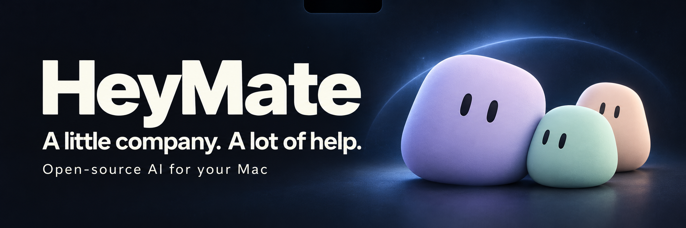
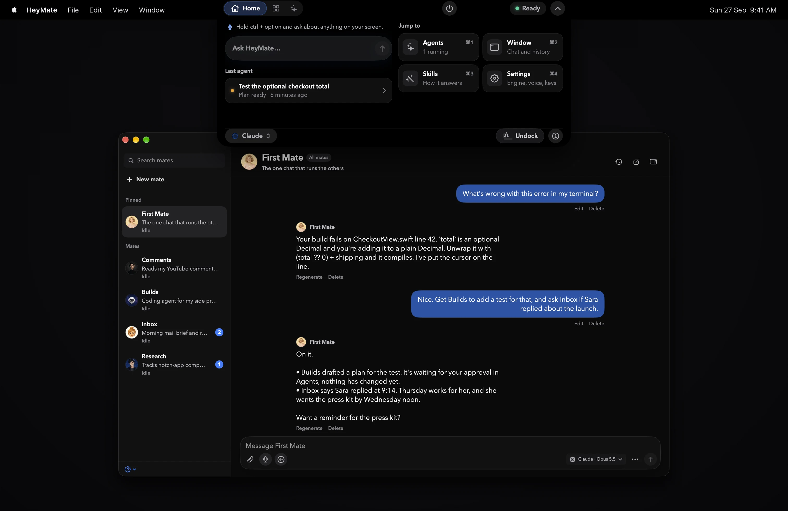
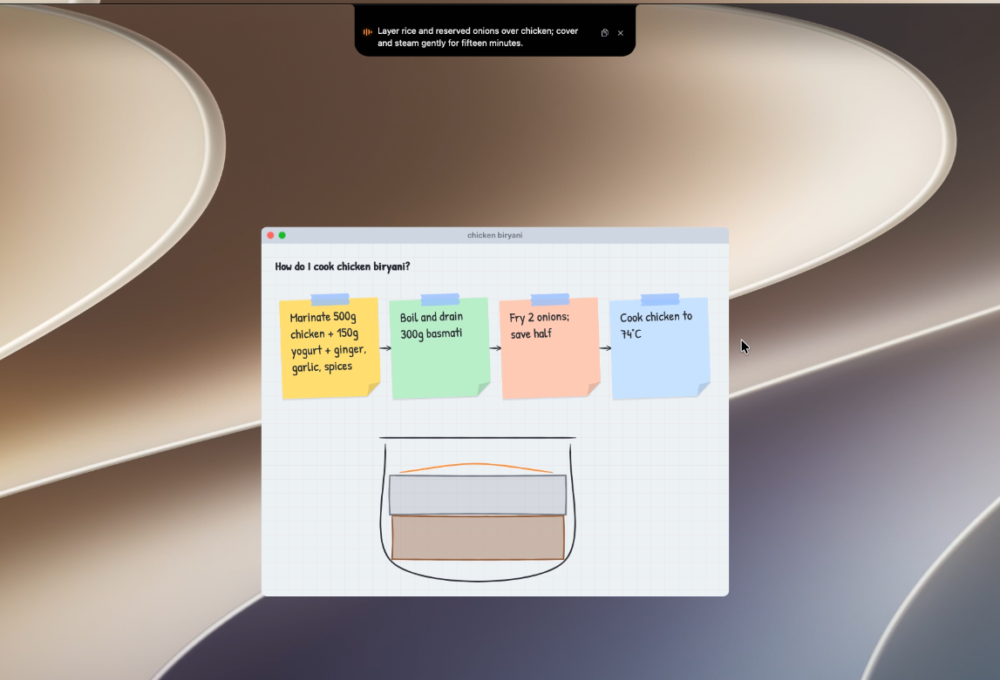
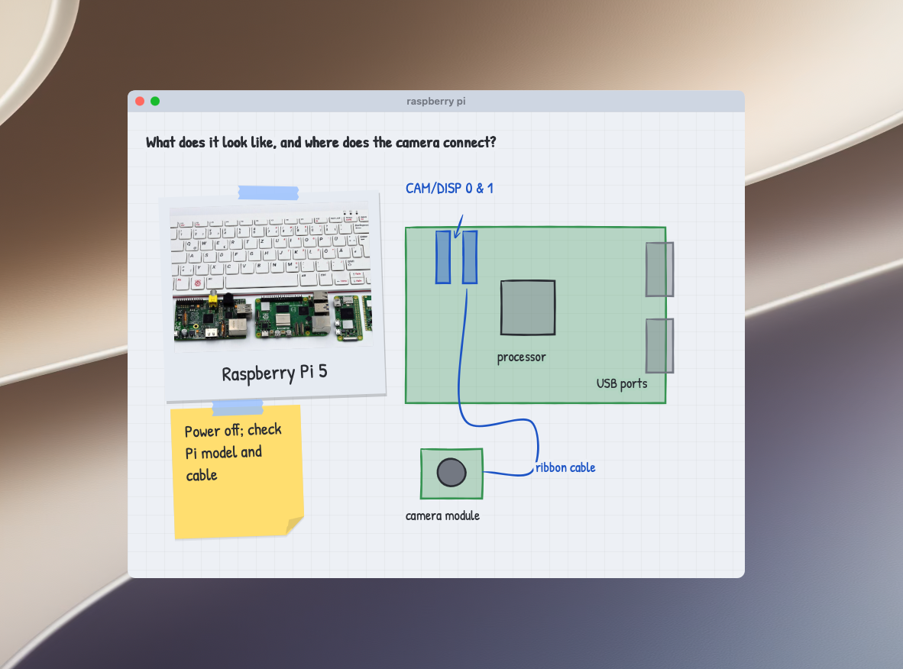
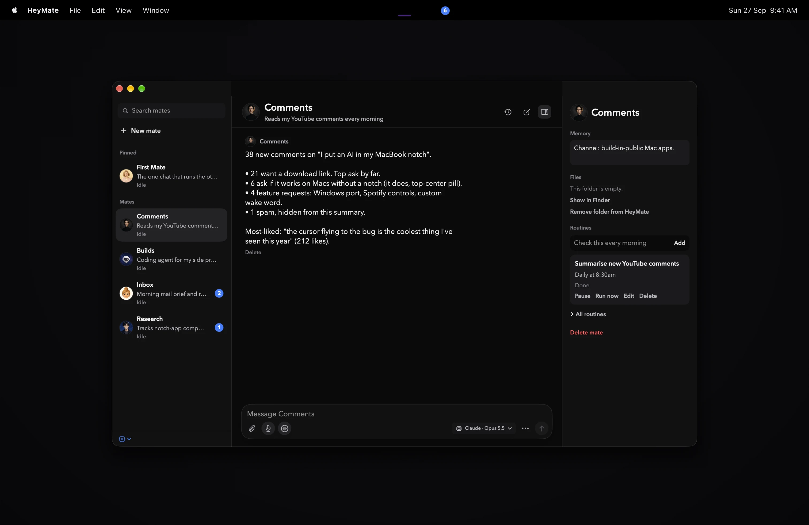
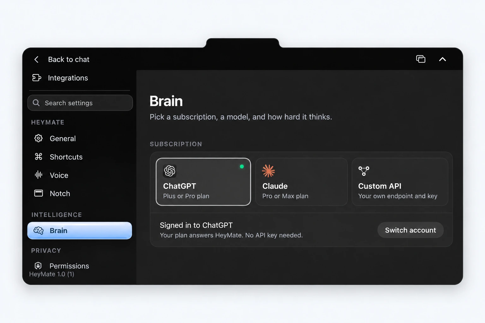
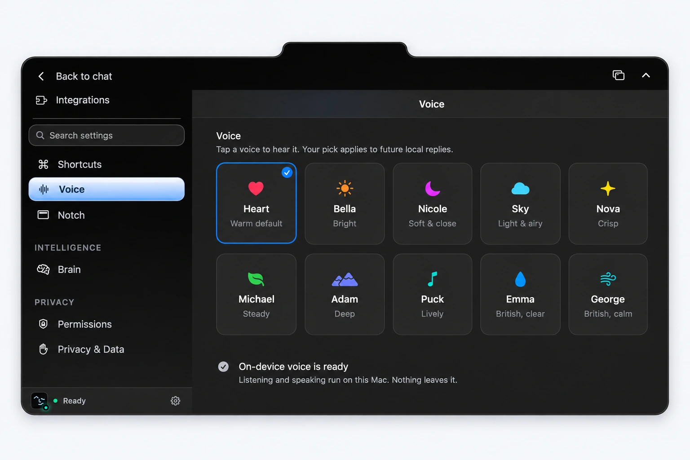

<div align="center">



Your open-source AI assistant for Mac. Talk about your screen, see answers take shape, and give your mates the busywork.

[](https://github.com/UmarSiddiqui/heymate/releases/latest) [](https://github.com/UmarSiddiqui/heymate/actions/workflows/release.yml)  [](LICENSE)

[**Download for Mac**](https://github.com/UmarSiddiqui/heymate/releases/latest/download/HeyMate.dmg) · [Website](https://getheymate.vercel.app) · [Blog & guides](https://getheymate.vercel.app/blog) · [Changelog](https://getheymate.vercel.app/changelog)

Free and open source · Apple silicon and Intel · Bring your own AI



<sub>HeyMate Home and mate chat, with example content. No notch? You get a top-center pill.</sub>

</div>

## One shortcut. A helping hand.

Hold <kbd>Control</kbd> + <kbd>Option</kbd>, ask, and let go. HeyMate answers out loud and can point to what it is explaining.

| You ask | HeyMate helps |
| --- | --- |
| “Walk me through this, one step at a time.” | Uses screen context, points to the next action, and waits while you try it. |
| “Take it from here.” | With computer control enabled and your approval, clicks and types. Click, type, or press Escape to take over. |
| “Give me a morning inbox brief.” | A mate handles the job, keeps notes, and can follow a routine. |

## Answers you can see

Drawings, diagrams, and 3D graphics appear over your desktop. Click a preview to watch.

<table>
  <tr>
    <td width="33%" align="center">
      <a href="https://getheymate.vercel.app/assets/video/visual-answers/biryani.mp4"></a><br>
      <strong>Explain it</strong><br><sub>“How do I cook chicken biryani?”</sub>
    </td>
    <td width="33%" align="center">
      <a href="https://getheymate.vercel.app/assets/video/visual-answers/camera.mp4"></a><br>
      <strong>Connect the dots</strong><br><sub>“Where does the camera connect?”</sub>
    </td>
    <td width="33%" align="center">
      <a href="https://getheymate.vercel.app/assets/video/visual-answers/board.mp4"></a><br>
      <strong>See it in 3D</strong><br><sub>“Show me the board in 3D.”</sub>
    </td>
  </tr>
</table>

<sub>Actual HeyMate recordings, condensed and sped up, with silent previews and graphics generated for the example questions.</sub>

## Mates with jobs

Describe a researcher, editor, scheduler, or coding helper in one sentence. Give it a face, personality, notes, and workspace. Set a task or routine, then follow the work in chat. Habits live in each mate’s `AGENTS.md`.

<p align="center">
  
</p>

Connect Mac apps, web apps through Composio, signed-in CLIs, and MCP servers. Connections are shared across mates. Agents can also use signed-in Chrome through the HeyMate extension. Actions that send, delete, or pay ask you first.

## Your AI. Your voice.

Use **ChatGPT (Codex), Claude**, or **Custom API** with either format:

| API format | Endpoint |
| --- | --- |
| **Anthropic-compatible** | Anthropic Messages (`/v1/messages`) |
| **OpenAI-compatible** | OpenAI Chat Completions (`/v1/chat/completions`); a base URL ending in `/v1` is enough. |

Compatible local servers work too. Set the format, server address, model, and API key in **Brain**.

<p align="center">
  
  
</p>

<sub>Illustrative settings artwork with cleaned backgrounds and example content; current controls may differ.</sub>

Downloaded Parakeet listening and Kokoro voices run locally on supported Apple silicon Macs. Kokoro is unavailable on macOS 26.4–26.5. Optional ElevenLabs receives the audio or text it processes.

HeyMate adds no subscription fee or model metering. Provider limits and optional API, voice, and connector charges apply. Features vary by provider, model, and connected tools. Screen guidance needs a vision-capable provider.

[Connect Claude or ChatGPT (Codex)](https://getheymate.vercel.app/connect-claude-codex) · [Explore workflows](https://getheymate.vercel.app/how-to-use-heymate)

## Get started

**macOS 14.2+ · Apple silicon or Intel**

1. Download [**HeyMate.dmg**](https://github.com/UmarSiddiqui/heymate/releases/latest/download/HeyMate.dmg) and drag HeyMate into **Applications**.
2. Launch `/Applications/HeyMate.app` and grant permissions for the features you want.
3. Connect your AI in **Brain**, choose a voice, and hold <kbd>Control</kbd> + <kbd>Option</kbd> to ask.

Or install with Homebrew:

```sh
brew install umarsiddiqui/tap/heymate
```

Current builds use a stable self-signed certificate and are **not Apple Developer ID-signed or notarized**. If macOS blocks the first launch, review the app and use **System Settings → Privacy & Security → Open Anyway** if you choose to proceed.

## Helpful. With boundaries.

Chats and memory live on your Mac. Relevant questions and screen context go to your chosen AI provider. Computer control needs your consent; optional usage analytics are off by default.

<details>
<summary>Storage, screen capture, and background work</summary>

- Chats, memory, mates, and routines live in `~/Library/Application Support/heymate/`. HeyMate chat history stores text, not screenshot or audio bytes.
- Active interactions can capture your screen, including between walkthrough steps. Some integrations use temporary screenshot files. Provider retention and CLI session history are separate.
- Connector credentials stay in a local file restricted to your Mac account. There is no HeyMate account service storing your chats.
- Routines, standing orders, and approved coding jobs can run in the background. Local undo cannot reverse sent messages or remote changes.
- Configured builds can collect usage counts with your consent, without chat text, screenshots, or files. Change this in **Settings → Privacy & Data**.

</details>

[Permissions](https://getheymate.vercel.app/permissions) · [Privacy details](https://getheymate.vercel.app/privacy)

<details>
<summary><strong>Build and contribute</strong></summary>

Native SwiftUI. Requires Xcode 26 and internet access to fetch Swift packages.

```sh
git clone https://github.com/UmarSiddiqui/heymate.git
cd heymate/heymate
open HeyMate.xcodeproj
```

Read [local development and permission continuity](heymate/docs/local-development.md) before building or installing locally:

```sh
./script/build_and_run.sh --check    # Check signing without interrupting the app
./script/build_and_run.sh --verify   # Build, install, and verify /Applications/HeyMate.app
```

Keep the installed certificate and compatible designated requirements. Never substitute ad-hoc signing or reset TCC. Preferences and sign-ins surviving do not prove macOS permission grants survived.

See [CONTRIBUTING.md](CONTRIBUTING.md) for checks and [open an issue](https://github.com/UmarSiddiqui/heymate/issues/new/choose) for bugs or ideas. Documentation and website-only changes do not publish an app build.

</details>

[GitHub Releases](https://github.com/UmarSiddiqui/heymate/releases) · [MIT license](LICENSE) · [Third-party notices](heymate/THIRD_PARTY_NOTICES.md)
