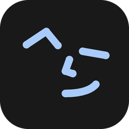
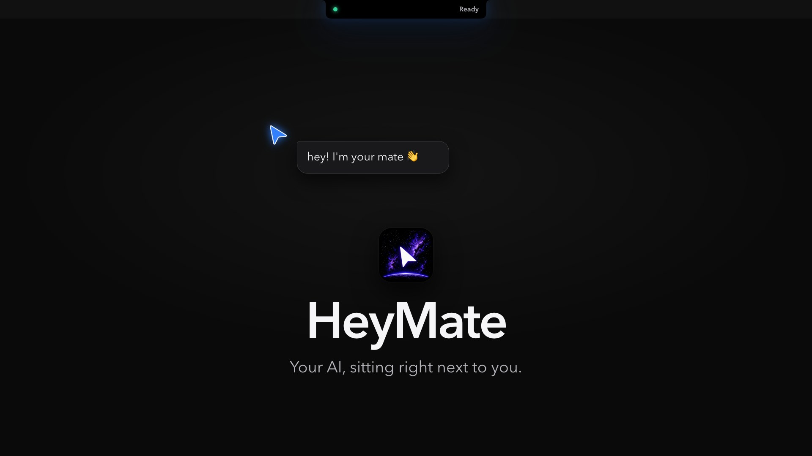
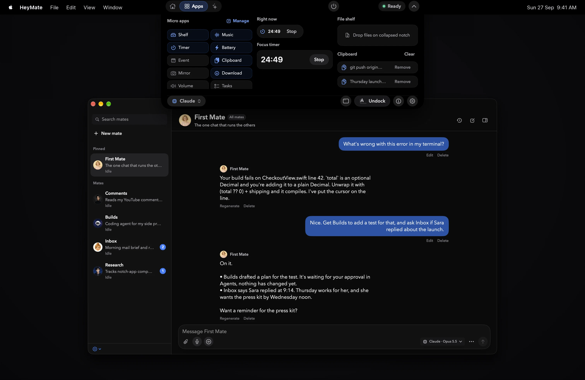
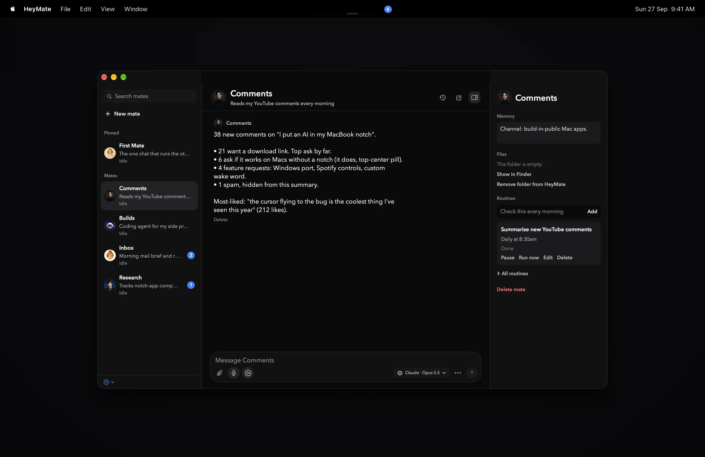
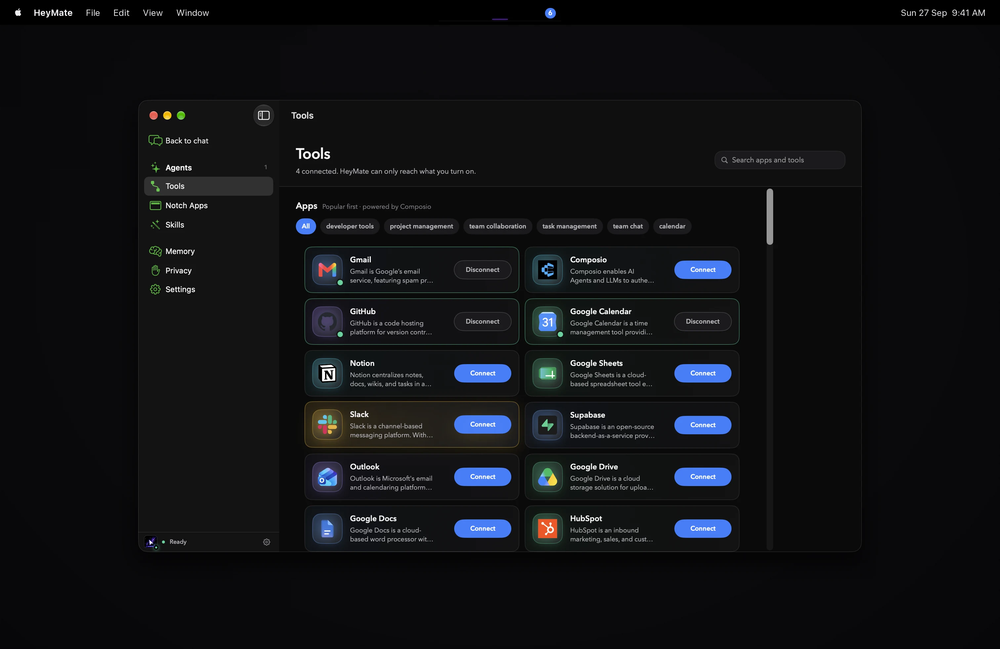

<div align="center">



# HeyMate

**Learn your software. One step at a time.**<br>
Ask how to do something in a desktop app or website. HeyMate points to the next step, explains it out loud, and waits while you try it. Free and open source, currently available for macOS. Works with your Claude or ChatGPT plan through their official CLIs.

[](https://github.com/UmarSiddiqui/heymate/releases/latest)
[](https://github.com/UmarSiddiqui/heymate/actions/workflows/release.yml)


[](heymate/LICENSE)

[**Download for Mac**](https://github.com/UmarSiddiqui/heymate/releases/latest/download/HeyMate.dmg) · [Website](https://getheymate.vercel.app) · [Watch the demo](https://getheymate.vercel.app/#demo) · [Changelog](https://github.com/UmarSiddiqui/heymate/releases)

<sub>Inspired by <a href="https://github.com/TheBoredTeam/boring.notch">Boring Notch</a>.</sub>

<br>

<a href="https://getheymate.vercel.app/#demo">
  
</a>

<sub>Hold <kbd>⌃</kbd> <kbd>⌥</kbd>, ask about anything on screen, let go. Illustrated example: ask "why is my Mac so slow?" and get a spoken answer with a pointer.</sub>

</div>

<br>

## Try a task you want to learn

Open a desktop app or website, hold <kbd>⌃</kbd> <kbd>⌥</kbd>, and ask **“Walk me through this, one step at a time.”** For example: “Show me how to remove this logo's background in Photopea.” Use a sample image you can share with your AI provider.

For a multi-step walkthrough, HeyMate shows a plan and points to the first action. Click the target or say “next”; it checks the screen again before explaining the next step. You do the task and learn the controls. Results depend on the selected model and what it can see; stop and correct it if a step is wrong.

Screen guidance needs a vision-capable provider. The optional Apple Intelligence brain answers text questions only.

## Why HeyMate

- **Help with desktop apps and websites.** Spoken explanations and a cursor that points at the control being discussed. Screen context is captured during active interactions that need it, including each step of a walkthrough.
- **Use your existing plan.** Claude Code, Codex, or OpenCode with your own sign-in. HeyMate is free; provider usage limits and optional paid services still apply.
- **Keep control of coding work.** Agents show a read-only plan before execution. Approved jobs get workspace snapshots for undo; external actions are subject to their tool's approval policy. Undo cannot reverse a sent message or an external service change.

<p align="center">
  <a href="https://getheymate.vercel.app/#demo"></a><br>
  <sub>▶ <a href="https://getheymate.vercel.app/#demo">Watch the 40-second illustrated tour</a> (recreated UI) · Music: <a href="https://soundcloud.com/peyruis">Show Me by Peyruis</a>, <a href="https://creativecommons.org/licenses/by/3.0/">CC BY 3.0</a></sub>
</p>

## Features

<table>
<tr>
<td width="50%" valign="top">

### Lives in the notch
Folds into the camera housing and opens on hover into **Home**, **Apps**, and **Agents**. Macs without a notch get a top-center pill. There is no dock icon and no menu-bar clutter.

Micro-apps for the space you never used: File Shelf with AirDrop, focus timers, Clipboard history, Now Playing with album art, Downloads, Camera Mirror, Volume and Brightness HUDs, Bluetooth devices, Battery, Next Event, and Reminders.

</td>
<td width="50%" valign="top">

</td>
</tr>
<tr>
<td width="50%" valign="top">

</td>
<td width="50%" valign="top">

### Coding agents, on a leash
"HeyMate agent, add dark mode to this project." HeyMate opens a sandbox in `~/Projects/heymate`, has Claude Code or Codex draft a **read-only plan**, and waits. Approve it, walk away, and it keeps running even if you quit.

Undo snapshots, Terminal takeover, completion receipts, and **Standing Orders**: HeyMate proposes work, but never starts it unasked.

</td>
</tr>
<tr>
<td width="50%" valign="top">

### Mates: helpers with a job of their own
Create a patient design tutor from the Mates view. Give it a name, a job, a personality prompt, a face, saved notes, and a workspace folder. Start with one clear job and tell it how you want it to help.

**Routines** run daily at a time you choose or every *N* hours, and results land in that mate's chat.

</td>
<td width="50%" valign="top">

</td>
</tr>
<tr>
<td width="50%" valign="top">

</td>
<td width="50%" valign="top">

### Plugs into what you already use
Apple Calendar, Reminders, Notes, Mail, Messages, and Shortcuts out of the box. Local `gh`, `git`, `docker`, `kubectl`, `vercel`, `supabase`, and `stripe` CLIs with your own logins. Any MCP server, plus 1,400+ toolkits through Composio with your own free key.

Read-only calls run quietly. Anything that sends, deletes, or pays always asks first.

</td>
</tr>
</table>

## Useful between questions

HeyMate also includes Now Playing, a file shelf with AirDrop, calendar and battery status, volume and brightness controls, a camera mirror, focus timers, clipboard history, and downloads. Enable the tools you use and leave the rest out of the way.

## Install

HeyMate is an early open-source release for macOS 14.2 or later. Current builds use a stable self-signed certificate; they are **not signed with Apple Developer ID or notarized by Apple**.

1. Download **[HeyMate.dmg](https://github.com/UmarSiddiqui/heymate/releases/latest/download/HeyMate.dmg)** and drag HeyMate into Applications. If macOS blocks the first launch, review the app and use **System Settings → Privacy & Security → Open Anyway** if you choose to proceed.
2. Grant **Microphone**, **Accessibility**, and **Screen Recording** when setup asks. [Why each permission?](https://getheymate.vercel.app/permissions)
3. Pick **Claude** or **ChatGPT** and finish the official CLI sign-in in your browser. Provider access and usage limits apply. The **Neither** option uses Apple Intelligence on supported Macs, for text-only questions.
4. Open a desktop app or website, hold <kbd>⌃</kbd> <kbd>⌥</kbd>, and ask for a walkthrough.

Alternative install methods:

```sh
brew install umarsiddiqui/tap/heymate
```

Or inspect the [installer source](website/install.sh) before running:

```sh
curl -fsSL https://getheymate.vercel.app/install.sh | bash
```

The script replaces `/Applications/HeyMate.app`, removes its quarantine attribute, and opens it. This does not provide Apple notarization. A SHA-256 file is included with each GitHub release.

App changes pushed to `main` trigger a GitHub Actions build and [release](https://github.com/UmarSiddiqui/heymate/releases). Documentation and website-only changes do not publish an app build.

Suggestions, bugs, or trouble installing? [Open an issue](https://github.com/UmarSiddiqui/heymate/issues/new/choose) or email me at [umarsiddiqui3037+heymate@gmail.com](mailto:umarsiddiqui3037+heymate@gmail.com?subject=HeyMate).

### Requirements

- macOS 14.2 or later, Apple silicon or Intel
- For screen guidance: a vision-capable Claude or ChatGPT plan, or another configured vision provider. Onboarding can install and sign in the CLI for you. Apple Intelligence is an optional text-only brain on supported Macs running macOS 26 or later; it cannot see the screen. To sign in yourself, or to use OpenCode:

| Brain | Command | Sign in | Notes |
| --- | --- | --- | --- |
| Claude | `claude` | `claude auth login --claudeai` | Default. Uses your Claude subscription, not Console billing. |
| Codex | `codex` | `codex login` | Signing in to the ChatGPT Mac app does not sign in the CLI. |
| OpenCode | `opencode` | `opencode auth login` | Free models need no provider credential. Headless jobs can edit files but cannot run shell commands. |

HeyMate finds CLIs through your login-shell `PATH` (Homebrew, npm, Bun, and `~/.local/bin` included). When Claude or Codex runs a job, HeyMate strips provider API-key and base-URL variables from the child process, so a stray `ANTHROPIC_API_KEY` or `OPENAI_API_KEY` can never switch you to metered billing.

## Privacy

> Screen context is used for active interactions that need it. Walkthroughs can capture again between steps. Enabled routines, standing orders, and approved coding jobs can run in the background.

- **On your disk.** HeyMate chat history stores text, not screenshot or audio bytes. Chats, memory, mates, and routines live in `~/Library/Application Support/heymate/`. Memory can be turned off or cleared in Settings.
- **Temporary images.** Some CLI integrations write screenshots to temporary files and clean them up when the request or process ends. The optional local-control interface retains screenshots temporarily for callers. CLI histories and AI-provider retention are separate from HeyMate's chat history.
- **Your providers.** Questions and relevant screen context go to your selected AI provider. Connector credentials are stored in a local file restricted to your Mac account and used to authenticate with services you connect. HeyMate has no account service storing your chats.
- **Voice.** Apple Speech uses on-device recognition when available for your language; otherwise it can use Apple's service. Downloaded Parakeet and Kokoro models run locally. ElevenLabs is optional and receives the audio or text it processes.
- **Excluded apps.** Password managers and System Settings are never captured by Talk, dictation, or screen-reading standing orders.
- **Invisible on calls.** One switch hides the notch and cursor from screen shares.
- **No analytics** unless a build explicitly supplies a PostHog key.

Coding CLIs still run as your macOS user. Plan mode limits writes, not reads.

Every macOS permission HeyMate can ask for, and exactly what it does with each, is on the [permissions page](https://getheymate.vercel.app/permissions).

<details>
<summary><strong>How the coding-agent workflow works</strong></summary>

<br>

A voice or typed request creates a sandbox folder with a `TASK.md`:

1. The selected CLI inspects the task and workspace with writes disabled.
2. HeyMate shows the plan and waits.
3. Approval creates an undo snapshot, resumes the same CLI session, and enables workspace writes.

Sandboxes live at `~/Projects/heymate/<task-slug>-<short-id>`. Choosing an existing folder uses the same plan gate, plus per-tool approval where the CLI supports it.

Approved execution moves into the separately signed `HeyMateAgentRunner` helper embedded at `HeyMate.app/Contents/Helpers`, so work survives Cmd-Q and reattaches on the next launch. Planning is limited to five awake minutes and each execution leg to fifteen; Mac sleep doesn't count. A crash-interrupted run keeps its pre-write undo snapshot.

OpenCode jobs cannot run shell commands or spawn subagents, because its CLI lacks an OS-enforced workspace sandbox. Use Claude Code or Codex when work must build or test itself.

</details>

## Build from source

Requires Xcode 26 and an internet connection on the first build to fetch Swift packages.

```bash
git clone https://github.com/UmarSiddiqui/heymate.git
cd heymate/heymate
open HeyMate.xcodeproj
```

Select the `HeyMate` scheme and **My Mac**, check **Signing & Capabilities** (pick your Personal Team), and press Run. A stable signing identity matters because macOS ties Accessibility and Screen Recording grants to it.

```bash
./scripts/typecheck.sh           # build the app without touching the signed app bundle
./scripts/typecheck.sh --tests   # also build the test targets
./script/build_and_run.sh --verify   # build, launch, and verify a project-local bundle
```

<details>
<summary><strong>Optional services: cloud voices, Custom API, OpenCode Talk</strong></summary>

<br>

**Voices.** Listen and Speak each have three options in Settings › Advanced › Listen & speak:

- **Mac** (default): Apple Speech for listening, and the best installed Mac voice for speaking (download a free Premium voice in System Settings › Accessibility › Spoken Content for a better one). Works out of the box.
- **On-device**: [Parakeet](https://huggingface.co/FluidInference/parakeet-tdt-0.6b-v3-coreml) listens and [Kokoro 82M](https://huggingface.co/FluidInference/kokoro-82m-coreml) speaks, both through [FluidAudio](https://github.com/FluidInference/FluidAudio) on the Neural Engine. One optional download (about 600 MB) from onboarding or Settings. Private, free, and works offline. Needs Apple Silicon.
- **ElevenLabs**: Scribe v2 Realtime for listening and ElevenLabs TTS for speaking, using your own ElevenLabs API key (stored privately on your Mac; the free plan works).

If ElevenLabs or on-device can't run, HeyMate falls back to the Mac voice for that turn.

**Cloudflare Worker (developers).** [`heymate/worker`](heymate/worker) can hold an ElevenLabs key server-side instead: it proxies TTS and mints Scribe single-use tokens. Every route requires a shared `HEYMATE_CLIENT_TOKEN` and fails closed without one. Put provider keys in the git-ignored `heymate/worker/.dev.vars` locally, or in Cloudflare secrets (`npx wrangler secret put HEYMATE_CLIENT_TOKEN`) when deployed. Give the app the same token through its environment or `~/.config/heymate/secrets.env` (`chmod 600` both files). Never put keys in `Info.plist`.

**Custom API.** Accepts any Anthropic Messages-compatible endpoint, model, and optional key (stored privately on your Mac). It answers Talk requests but doesn't run coding-agent jobs.

**OpenCode Talk.** Run `opencode serve` first. HeyMate defaults to `http://127.0.0.1:4096`. Plain HTTP is allowed only on loopback addresses.

</details>

### Repository layout

| Path | What's there |
| --- | --- |
| [`heymate/HeyMate`](heymate/HeyMate) | The SwiftUI app |
| [`heymate/HeyMateTests`](heymate/HeyMateTests) · [`UITests`](heymate/HeyMateUITests) | Unit and UI tests |
| [`heymate/worker`](heymate/worker) | Optional Cloudflare Worker that holds an ElevenLabs key for developers |
| [`website`](website) | The landing page |
| [`marketing/demo-video`](marketing/demo-video) | The Remotion project that renders the demo video |
| [`.github/workflows`](.github/workflows) | The build-and-release pipeline |

## Known limitations

- Builds use a stable self-signed certificate, not Apple Developer ID, and are not notarized. A downloaded DMG can require System Settings → Privacy & Security → Open Anyway on first launch.
- Screen Recording permission can lag until the next launch after you grant it.
- OpenCode Talk needs `opencode serve` running.

## Help build HeyMate

Read [CONTRIBUTING.md](CONTRIBUTING.md) for setup, verification, and three bounded starter tasks. Useful contributions include a reproducible walkthrough failure, a clearer first-run instruction, or a small accessibility fix. No Swift experience is needed to test a task or improve the website.

Check [open pull requests](https://github.com/UmarSiddiqui/heymate/pulls) before starting so work does not overlap. Include what you tried, the app version and provider, and what happened; remove private screen content before sharing.

## License

MIT. See [`LICENSE`](LICENSE). Notices for third-party code are in [`heymate/THIRD_PARTY_NOTICES.md`](heymate/THIRD_PARTY_NOTICES.md).

<sub>Not affiliated with Apple, Anthropic, or OpenAI. Claude, ChatGPT, and macOS are trademarks of their respective owners.</sub>
