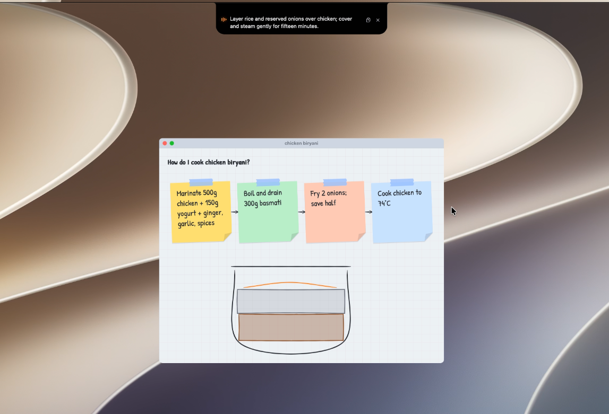
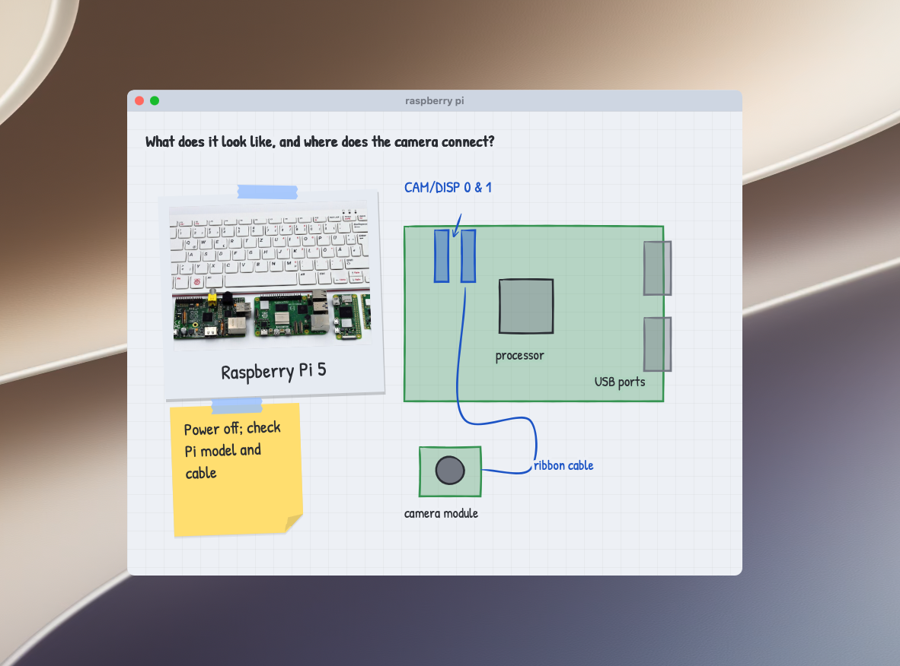
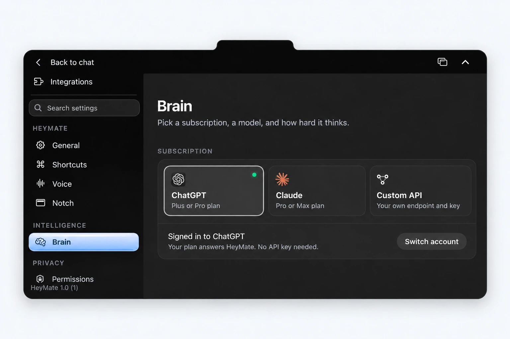
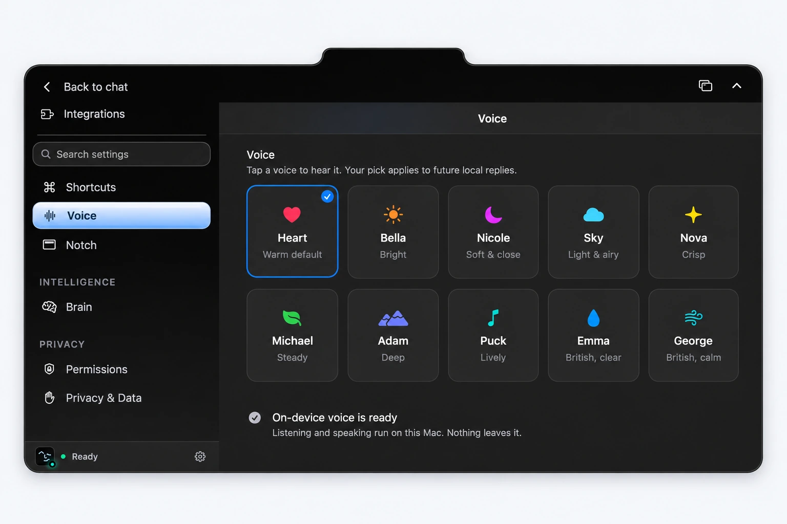

<div align="center">


# HeyMate

### A little company. A lot of help.

Your open-source AI assistant for Mac. Ask about your screen, get help with the next click, and give your mates the busywork.

[](https://github.com/UmarSiddiqui/heymate/releases/latest)
[](https://github.com/UmarSiddiqui/heymate/actions/workflows/release.yml)

[](LICENSE)

[**Download for Mac**](https://github.com/UmarSiddiqui/heymate/releases/latest/download/HeyMate.dmg) · [Website](https://getheymate.vercel.app) · [Watch it draw](https://getheymate.vercel.app/#visual-answers) · [Changelog](https://getheymate.vercel.app/changelog)

Free and open source · Apple silicon and Intel · Bring your own AI

</div>

## Let HeyMate drive

From “where do I click?” to “take it from here.” Ask for help in a desktop app or website, including tools like CapCut. Enable computer control and approve the actions; HeyMate can click and type for you. Click, type, or press Escape to take over.

<p align="center">
  
</p>

You choose when to hand over control. [See how permissions work](https://getheymate.vercel.app/permissions).

## Mates with jobs

Give each mate a role and a personality. Delegate, then check back.

Describe a job in one sentence: a researcher, editor, scheduler, reviewer, or patient design tutor. Your AI drafts a name, personality, habits, approval boundaries, and a first task. Customize its face, notes, and workspace folder. Habits are saved in the mate's `AGENTS.md`.

Set a task or a routine, then follow the work in chat. Routines can run daily at a chosen time or every *N* hours.

> “Research competitors. Give me a brief every Friday.”

<p align="center">
  
</p>

## Talk, don't type

Hold <kbd>Control</kbd> + <kbd>Option</kbd>, ask naturally, and let go. HeyMate responds out loud and can point to what it is explaining.

Choose Mac speech, downloaded on-device listening and voices, or optional ElevenLabs. Downloaded Parakeet and Kokoro models process speech locally on supported Apple silicon Macs. Apple Speech uses on-device recognition when available for your language and can otherwise use Apple's service. ElevenLabs receives the audio or text it processes.

## Bring your AI

Use ChatGPT (Codex), Claude, OpenCode, or a custom Anthropic-compatible API endpoint, including a compatible local model setup. Choose the provider and model that fit your work.

HeyMate is MIT licensed, adds no subscription fee, and does not meter model use. Your provider's limits and optional API, voice, and connector charges still apply. Capabilities vary by provider and model.

Screen guidance needs a vision-capable provider. Optional Apple Intelligence supports text-only questions on eligible Macs running macOS 26 or later; it cannot see your screen.

## Integrate with your apps

Connect the tools you use. Give your mates access to your calendar, files, and everyday work.

Integrations are shared across HeyMate and all your agents. Connect an app once and every agent can use it; turn it off and it is off everywhere.

| On your Mac | On the web | Your own tools |
| --- | --- | --- |
| Calendar, Reminders, Notes, Mail, Messages, Contacts, Shortcuts, Music, and Maps | Google Drive, Gmail, Google Calendar, Docs, Sheets, Slack, Notion, Linear, Jira, HubSpot, Figma, YouTube, and more through Composio | Signed-in `gh`, `git`, `docker`, `kubectl`, `vercel`, `supabase`, and `stripe` CLIs, plus MCP servers |

Connect web apps through Composio with your own key and account sign-ins. Agents can also work in signed-in Chrome through the HeyMate extension. Service access, limits, and fees apply.

Reading runs quietly. Actions that send, delete, or pay ask you first.

## Answers you can see

Some answers need a picture. Ask about your screen or something you want to understand. HeyMate draws 2D explanations, diagrams, and 3D graphics directly over your desktop.

### 2D explanations

A recipe becomes a sketch. Ask **“How do I cook chicken biryani?”** and watch ingredients and layers take shape, step by step.

[](https://getheymate.vercel.app/assets/video/visual-answers/biryani.mp4)

### Connection diagrams

Ask **“Where does the camera connect to a Raspberry Pi?”** A drawing makes the board, connector, and cable visible.

[](https://getheymate.vercel.app/assets/video/visual-answers/camera.mp4)

### 3D graphics

Ask **“Show me the board in 3D.”** See the shape, ports, and parts from different angles.

[](https://getheymate.vercel.app/assets/video/visual-answers/board.mp4)

Click an image to watch its recording. These are actual HeyMate recordings, condensed and sped up, with silent previews and graphics generated for the example questions.

1. **Ask naturally.** About what is on screen or something you want to understand.
2. **Watch it take shape.** Drawings, labels, and 3D graphics appear over your desktop.
3. **Keep asking.** Follow up when you want another detail explained.

[Explore the visual answers on the website](https://getheymate.vercel.app/#visual-answers).

## Less switching. More doing.

### Ask about what you see

Open an app or website, hold <kbd>Control</kbd> + <kbd>Option</kbd>, and ask **“Walk me through this, one step at a time.”** HeyMate can show a plan, point to the current action, and wait while you try it. Click the target or say “next”; it checks fresh screen context before continuing. Model mistakes remain possible; correct a step when needed.

[Explore screen guidance](https://getheymate.vercel.app/screen-guidance).

### Give it the wheel

Enable computer control when you want help doing the task. Approve the actions and take over at any time by clicking, typing, or pressing Escape.

### A mate for the busywork

Give a mate your inbox, research, or code. Follow progress in chat and reply to task updates. Coding jobs can show a read-only plan before execution, with workspace snapshots for local undo. Approved work can continue in a background helper after the app quits. Undo cannot reverse a sent message or a remote service change.

### Keep the useful bits

Keep ideas and results in Notes, return to past chats, and check task updates. The notch brings Home and AI usage into one small space. Macs without a notch get a top-center pill.

Optional tools include music controls, a file shelf with AirDrop, focus timers, clipboard history, calendar and battery status, volume and brightness controls, a camera mirror, and downloads.

## Your AI. Your voice.

Choose the AI that answers and the voice you hear. Make your mate feel like yours.

<p align="center">
  
  
</p>

Settings images use screenshot-based artwork with cleaned backgrounds and example content. On-device listening and speech stay on your Mac; AI answers use your chosen provider.

[Connect Claude or ChatGPT (Codex)](https://getheymate.vercel.app/connect-claude-codex) · [Explore everyday workflows](https://getheymate.vercel.app/how-to-use-heymate)

## Helpful. With boundaries.

You choose the AI and connected apps. Relevant questions and screen context go to that provider. Computer control needs your consent.

- **Local chat history.** Chats, memory, mates, and routines live in `~/Library/Application Support/heymate/`. HeyMate chat history stores text, not screenshot or audio bytes.
- **Screen context when needed.** Active interactions can capture your screen, including fresh captures between walkthrough steps. Some integrations use temporary screenshot files. Provider retention and CLI session history are separate from HeyMate's local history.
- **Your connections.** Connector credentials are stored locally in a file restricted to your Mac account. There is no HeyMate account service storing your chats.
- **Background work you enable.** Routines, standing orders, and approved coding jobs can run in the background.
- **Optional usage analytics.** Off by default. Configured builds can collect usage counts with your consent, without chat text, screenshots, or files. Change this in Settings → Privacy & Data.

[Understand permissions](https://getheymate.vercel.app/permissions) · [Read the privacy details](https://getheymate.vercel.app/privacy)

## What's new

Follow improvements to screen guidance and drawings, signed-in Chrome support, floating job updates, and the agent runtime in the [website changelog](https://getheymate.vercel.app/changelog).

For published app versions, downloads, and release notes, see [GitHub Releases](https://github.com/UmarSiddiqui/heymate/releases).

## Your next good idea could use a mate

Requires **macOS 14.2 or later**, on **Apple silicon or Intel**.

1. Download **[HeyMate.dmg](https://github.com/UmarSiddiqui/heymate/releases/latest/download/HeyMate.dmg)** and drag HeyMate into **Applications**.
2. Launch `/Applications/HeyMate.app` and grant the permissions requested for the features you want, including Microphone, Accessibility, and Screen Recording.
3. Connect your AI in **Brain** and choose a voice.
4. Hold <kbd>Control</kbd> + <kbd>Option</kbd> and start with one small task.

Current builds use a stable self-signed certificate. They are **not Apple Developer ID-signed or notarized**. If macOS blocks the first launch, review the app and use **System Settings → Privacy & Security → Open Anyway** if you choose to proceed.

Alternatively, install with Homebrew:

```sh
brew install umarsiddiqui/tap/heymate
```

[Need a hand getting started?](https://getheymate.vercel.app/how-to-use-heymate)

## Build and contribute

HeyMate is a native SwiftUI app. Building requires Xcode 26 and an internet connection to fetch Swift packages.

```sh
git clone https://github.com/UmarSiddiqui/heymate.git
cd heymate/heymate
open HeyMate.xcodeproj
```

For local builds and installs, read [local development and permission continuity](heymate/docs/local-development.md). Use the signing-preserving workflow:

```sh
./script/build_and_run.sh --check    # Check signing without interrupting the app
./script/build_and_run.sh --verify   # Build, install, and verify /Applications/HeyMate.app
```

Keep the installed signing certificate and compatible designated requirements. Do not substitute ad-hoc signing or reset TCC. Existing preferences and sign-ins do not prove macOS permission grants survived.

See [CONTRIBUTING.md](CONTRIBUTING.md) for development checks and [open an issue](https://github.com/UmarSiddiqui/heymate/issues/new/choose) for bugs, installation trouble, or feature requests. Documentation and website-only changes do not publish an app build.

[MIT license](LICENSE) · [Third-party notices](heymate/THIRD_PARTY_NOTICES.md)
